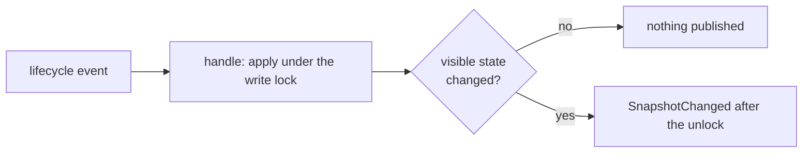

# app/registry

The runtime read model. The store keeps one `model.Snapshot` and projects the lifecycle events into it.
The TUI, the REST API, the log socket server and the resource sampler read it. None of them keeps a copy.

## The snapshot

- `model.Snapshot` holds the phase, the profile, the start time, the API state, the tiers and the services
- a tier and the `Services` map point at the same `*model.Service`. The order comes from `Tiers`
- one `sync.RWMutex` guards the snapshot. Nothing is copied on read

## Projection

- the subscription is required and filtered to the types in `projected`
- `handle` runs each message through `apply` under the write lock. An `apply<Event>` handler in `store.go` changes the snapshot in place
- `SnapshotChanged` carries nothing and is not critical. A slow reader loses a notification, never a fact

The rules worth knowing:

- `ProfileResolved` reallocates the store's own tiers and services from the payload on every occurrence. No payload aliases registry state
- `ServiceStarting` records the PID and the attempt time. It clears the error and the usage
- `ServiceFailed` keeps the error text and drops the PID
- a resource sample applies only where its PID still matches the service

## Reads

- `Read(fn)` runs `fn` under the read lock
- `WaitResolved(ctx)` blocks until the first `ProfileResolved`. The log socket server waits on it before it binds
- `WaitSettled(ctx, id, since)` blocks until an event stamped at or after `since` leaves the service running, failed or stopped.
  A running service with a `watch` block also waits for `Watching`, so a settled start never answers `watching: false`.
  It returns `ErrServiceNotFound` for an unknown id

Each consumer reads what it needs inside `Read` and does the slow part outside:

- REST serializes inside `Read` and writes the response after it
- the sampler collects the live PIDs inside `Read` and samples them after it
- the log socket server reads the profile and the service names inside `Read`
- the TUI handles each message and renders each frame inside `Read`. It reads again once a second to recover a dropped notification

## Changing it

- the bus loop is the only caller of `handle`, and nothing else changes the snapshot. A new writer publishes an event instead
- a `Read` callback does no IO, never calls `Read`, `handle` or `Control`, never publishes and never blocks. The lock is not reentrant
- a callback reads through the snapshot only while it runs
- a stored service is a shallow copy.
  It shares the `Readiness`, `Watch` and `Environment` pointers and the `LogOutput` slice with the project and the payload.
  Nothing writes through them
- a new projected type is a row in `projected` and one `apply` handler. The handler reports whether the visible state changed.
  Returning true for an unchanged state publishes a useless notification.
  `applyWatching` is the exception: it returns true whenever the service exists, without comparing the previous value
- the store is the only projection. A frontend that needs a derived fact computes it inside `Read`
- admission never reads the snapshot. `app/services` keeps its own facts
